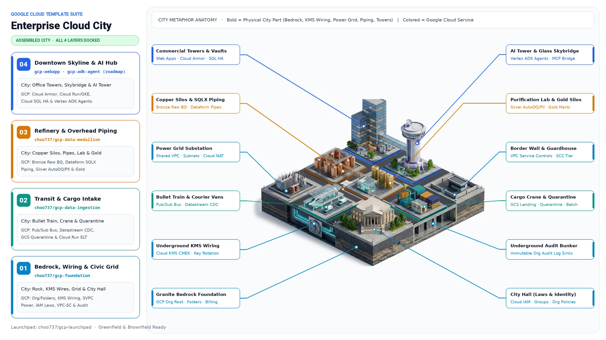
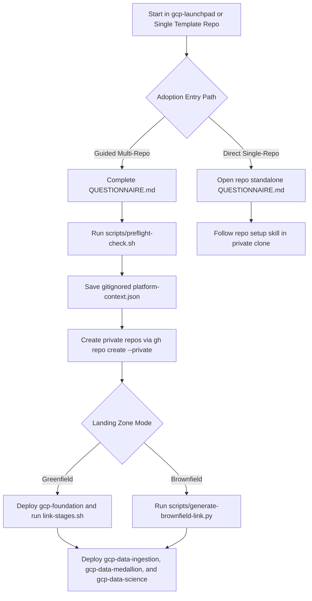

**00 Launchpad** · [01 Foundation](https://github.com/choo737/gcp-foundation) · [02 Ingestion](https://github.com/choo737/gcp-data-ingestion) · [03 Medallion](https://github.com/choo737/gcp-data-medallion) · [04 Data Science](https://github.com/choo737/gcp-data-science)

# GCP Launchpad

Plan, inspect, and bootstrap a production Google Cloud platform across four modular districts.
Works for new greenfield organizations, existing brownfield projects, or single-project sandboxes.

**How a planned cloud protects your business:** without city planning, open borders and tangled wires create risk.
`gcp-launchpad` builds the city foundation first across four districts.



## Quick Orientation

Pick the path matching your Google Cloud starting point.

| Your Scenario | Repositories Needed | Est. Setup | Idle Cost Floor |
| --- | --- | --- | --- |
| **New GCP Org (Greenfield)** | `00` -> `01` -> `02` -> `03` -> `04` | ~35 min | `$0/mo` serverless baseline |
| **Existing GCP Projects (Brownfield)** | `00` + any single district (`02`, `03`, or `04`) | ~10 min | Uses existing VPC and BigQuery |
| **1-Project Sandbox Trial** | Any repo `sandbox` stage + teardown | ~8 min | `$0/mo` after `terraform destroy` |

## Start in 3 Steps

1. **Create your private repository** (GitHub forces standard forks of public repos to stay public):

```bash
gh repo create example-org/gcp-launchpad --private --template choo737/gcp-launchpad --clone
cd gcp-launchpad
gh repo view --json isPrivate --jq '.isPrivate'
```

Confirm `gh repo view` prints `true` before saving `platform-context.json`.

2. **Run with your AI coding agent** (`Claude Code`, `OpenAI Codex`, `Gemini CLI`, or `Antigravity`):

```text
Read AGENTS.md, QUESTIONNAIRE.md, and .agents/skills/route-architecture/SKILL.md.
Guide me through intake, run scripts/preflight-check.sh, and write gitignored platform-context.json.
```

3. **Verify locally**:

```bash
make preflight
make test
```

## Platform Districts

| Repository | District & Layer | Core Capabilities | Status |
| --- | --- | --- | --- |
| **gcp-launchpad** *(this repo)* | `00` City Planning Hub | Intake Q&A, preflight check, and Brownfield bridge | Active |
| [gcp-foundation](https://github.com/choo737/gcp-foundation) | `01` Governance & Utilities | Folders, 38 Org Policies, Shared VPC, VPC-SC, KMS, and SCC | Active |
| [gcp-data-ingestion](https://github.com/choo737/gcp-data-ingestion) | `02` Entry Ports & Bridges | Pub/Sub + DLQ, Datastream CDC, Cloud Run jobs, and Workflows | Active |
| [gcp-data-medallion](https://github.com/choo737/gcp-data-medallion) | `03` Warehouses & Quality | BigQuery Bronze/Silver/Gold, Dataform, and Knowledge Catalog | Active |
| [gcp-data-science](https://github.com/choo737/gcp-data-science) | `04` Offices, AI & Homes | Agent Platform, BigQuery ML, TreeSHAP XAI, and WORM ledger | Active |
| `gcp-webapp` *(Planned)* | Hosted App Template | HTTPS Load Balancer, Cloud Armor, Cloud Run, and Cloud SQL | Roadmap |
| `gcp-adk-agent` *(Planned)* | Hosted Agent Template | Google ADK on Agent Runtime or Cloud Run with eval gates | Roadmap |

## Technical Reference

<details open>
<summary><strong>1. Architecture, Mermaid Flow & 2026 Product Naming</strong></summary>

Teams can start in `gcp-launchpad` for multi-repo platforms or adopt one downstream template directly.



- **Greenfield `link-stages.sh`**: Deploy `gcp-foundation` first, then link `dev`, `uat`, and `prod` outputs downstream.
- **Brownfield `scripts/generate-brownfield-link.py`**: Skip `gcp-foundation` and emit `00_linked.auto.tfvars.json` (`0600`) for ingestion, data-science, or apps.
- **7-Team & App Factory**: Map `enterprise_teams`, `department_budgets`, `create_dedicated_secops_project`, and `applications` into `gcp-foundation/apps/enterprise`.
- **Top-level folders**: Uses `fldr-coe`, `fldr-network`, and `fldr-environments` (`fldr-prod`, `fldr-uat`, `fldr-dev`).
- **Environment layout**: Each tier holds `fldr-<env>-data-platform`, `fldr-<env>-ai-platform`, and `fldr-<env>-app-platform`. App folders use `fldr-<env>-<key>`.
- **Project naming**: Uses `prj-coe-*` and `prj-<env>-<workload>-<hash4>` (`dev`, `uat`, `prod`) with `split_etl_project = false`.
- **2026 data names**: Uses Knowledge Catalog (formerly Dataplex) and Managed Airflow Gen 3 (formerly Cloud Composer 3).
- **2026 AI names**: Uses Agent Platform (formerly Vertex AI) and Agent Runtime (formerly Vertex AI Agent Engine).

</details>

<details open>
<summary><strong>2. Prerequisites, Keyless WIF CI/CD & Cost Guardrails</strong></summary>

Choose a `team_size_tier` matching team boundaries, GitHub plan features, and regulatory separation rules.

| Tier | Profile | CI Identity Scope | GitHub Plan Gating |
| --- | --- | --- | --- |
| `S` | Small pilot (`1-5` engineers) | Single deployer WIF SA across stages | Works on `github_free` (branch rules only) |
| `M` | Growth (`5-20` engineers) | Scoped `tf_foundation_ci`, `tf_ingestion_ci`, and `dataform_ci` | `github_team` adds private `CODEOWNERS` enforcement |
| `L` | Regulated SoD + External Vendor Split | Per-stage foundation SAs plus BU `domain_name` namespaces | `github_enterprise` adds Environment Required Reviewers |

- **Zero-idle baseline**: Serverless `dev` and `uat` plus `0` baseline `prod` slots cost `$0/mo` idle.
- **Slot commitment option**: Opting into `100` baseline slots in `asia-southeast1` costs `$5,365.50/mo` PAYG.
- **NGFW Enterprise option**: Opting into `enable_ngfw_enterprise = true` adds `$2,555/mo/env` plus inspection charges.
- **Hardened CI**: `.github/workflows/ci.yml` pins 40-char commit SHAs, uses `contents: read`, and runs `make preflight` plus `make test`.

</details>

<details open>
<summary><strong>3. Repository Layout, Agent Skills & Day-0 to Day-2 Guides</strong></summary>

### Agent Prompts & Skills

```text
# Claude Code (Brownfield shortcut)
Read CLAUDE.md, QUESTIONNAIRE.md, and .agents/skills/brownfield-bridge/SKILL.md.
Inspect my existing GCP projects and generate 00_linked.auto.tfvars.json.
```

| Skill | File | Purpose |
| --- | --- | --- |
| `route-architecture` | `.agents/skills/route-architecture/SKILL.md` | Guides intake questions, runs preflight checks, writes `platform-context.json`, and clones private repos |
| `brownfield-bridge` | `.agents/skills/brownfield-bridge/SKILL.md` | Inspects existing GCP resources, updates `platform-context.json`, and writes `00_linked.auto.tfvars.json` |

### Repository Layout

- `README.md`, `QUESTIONNAIRE.md`, `AGENTS.md`, `CLAUDE.md`, `CODEOWNERS`, `Makefile`: Standard suite entry files.
- `assets/`: Lossless `2x` Cloud City overview and org setup check diagrams.
- `scripts/`: `preflight-check.sh`, `generate-brownfield-link.py` (`0600`), and `audit-suite-uniformity.py`.
- `examples/` & `tests/`: Reference `platform-context.*.json` files plus `suite_doc_contract.py` and integrity tests.

### Day-0 to Day-2 Guides & Sibling Playbooks

- [Tier-1 Architecture Router Questionnaire](QUESTIONNAIRE.md)
- [End-to-End Operational Playbook (6 Steps)](docs/01-end-to-end-operational-playbook.md)
- [Template Documentation Standard](docs/02-template-documentation-standard.md)
- [Org Completeness Scanner Design Spec (Roadmap)](docs/03-org-completeness-scanner-design.md)
- [gcp-foundation Operational Guide](https://github.com/choo737/gcp-foundation/blob/main/docs/05-enterprise-operationalization-guide.md)
- [gcp-data-ingestion Operational Guide](https://github.com/choo737/gcp-data-ingestion/blob/main/docs/03-enterprise-adoption-guide.md)
- [gcp-data-medallion Operational Guide](https://github.com/choo737/gcp-data-medallion/blob/main/docs/02-enterprise-operationalization-guide.md)
- [gcp-data-science Operational Guide](https://github.com/choo737/gcp-data-science/blob/main/docs/01-six-step-operationalization.md)

</details>

## License

Apache License 2.0. See [LICENSE](LICENSE).

**Disclaimer:** This is a personal project. The views, code, and opinions expressed are my own and do not represent my current or past employers.
