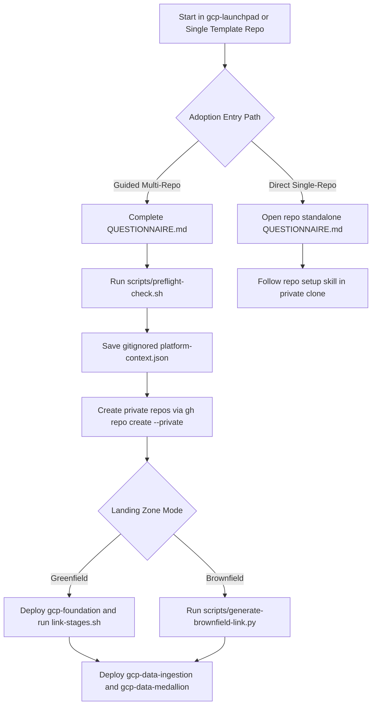

# GCP Launchpad

`gcp-launchpad` is the starting repo for the `choo737` Google Cloud template set.

Use it to map requirements, inspect existing GCP projects, and spin up private repositories.

## Template Suite Overview


Each repository owns one layer: `01` foundation, `02` ingestion, `03` warehouse, and `04` apps and agents.
Together they fit into a single Google Cloud environment without overlapping ownership.

| Template Repository | Status | Included Capabilities | Best For |
| --- | --- | --- | --- |
| **gcp-launchpad** *(this repo)* | Active | Intake questionnaire, preflight checks, Brownfield bridge, and playbook | Multi-repo planning and team handoffs |
| [gcp-foundation](https://github.com/choo737/gcp-foundation) | Active | Landing Zone, Folders, Shared VPC, VPC-SC, KMS, SCC, Audit Logs, BigQuery, WIF | Greenfield orgs, regulated FSI, or brownfield folders |
| [gcp-data-ingestion](https://github.com/choo737/gcp-data-ingestion) | Active | Datastream CDC, Pub/Sub Streaming + DLQ, Cloud Run Batch ELT, Workflows, Composer 3 | Greenfield linked or standalone Brownfield zones |
| [gcp-data-medallion](https://github.com/choo737/gcp-data-medallion) | Active | Dataform `3.1.5` SQLX Medallion, Dual-Tier PII Tags, Dataplex Auto DQ, Tag Promotion | Greenfield or standalone Brownfield BigQuery Bronze |
| `gcp-webapp` *(Planned)* | Roadmap | HA Web App with HTTPS Load Balancer, Cloud Armor, Cloud Run, Cloud SQL | Customer portals on Greenfield or Brownfield VPCs |
| `gcp-adk-agent` *(Planned)* | Roadmap | Google ADK Agent on Agent Engine or Cloud Run with Eval Gate | Enterprise AI agents routed via runtime choice |

## Create Your Private Repository (Do Not Fork Publicly)

GitHub forces normal forks of public repositories to stay public.

Always create private customer repositories with `--private` before saving `platform-context.json` or cloning downstream templates.

```bash
gh repo create <org>/gcp-launchpad --private --template choo737/gcp-launchpad --clone
cd gcp-launchpad
gh repo view --json isPrivate --jq '.isPrivate'
```

Confirm `gh repo view` prints `true` before storing any customer identifiers.

## Architecture & Capabilities

Teams can start in `gcp-launchpad` for multi-repo platforms or adopt one downstream template directly.



- **Greenfield `link-stages.sh`**: Deploy `gcp-foundation` first, then run `link-stages.sh` to export outputs into downstream stages.
- **Brownfield `scripts/generate-brownfield-link.py`**: Skip `gcp-foundation` and write `00_linked.auto.tfvars.json` (`0600`) from existing landing zone IDs.
- **Single-repo adoption**: Each template keeps its own standalone `QUESTIONNAIRE.md` for direct adoption without `gcp-launchpad`.

### Team Size & Separation of Duties Tiers (`team_size_tier`)

Choose a tier matching team boundaries, GitHub plan features, and regulatory separation rules.

| Tier | Profile | CI Identity Scope | GitHub Plan Gating |
| --- | --- | --- | --- |
| `S` | Small pilot (`1-5` engineers) | Single deployer WIF SA across stages | Works on `github_free` (branch rules only) |
| `M` | Growth (`5-20` engineers) | Scoped `tf_foundation_ci`, `tf_ingestion_ci`, and `dataform_ci` | `github_team` adds private `CODEOWNERS` enforcement |
| `L` | Regulated SoD + External Vendor Split | Per-stage foundation SAs plus BU `domain_name` namespaces | `github_enterprise` adds Environment Required Reviewers |

- **GitHub Free (`github_free`)**: Lacks private repo `CODEOWNERS` checks and Environment Required Reviewers.
- **GitHub Team (`github_team`)**: Enables `CODEOWNERS` approval rules on private repositories.
- **GitHub Enterprise (`github_enterprise`)**: Adds Environment Required Reviewers on `staging` and `prod` deployments.

### Monthly Idle Cost Floor Defaults

- **Zero-idle baseline**: Serverless `dev`/`staging` plus `0` baseline `prod` slots cost `$0/mo` idle.
- **Slot commitment option**: Opting into `100` baseline slots in `asia-southeast1` costs `$5,365.50/mo` PAYG.
- **NGFW Enterprise option**: Opting into `enable_ngfw_enterprise = true` adds `$2,555/mo/env` plus inspection charges.

## 6-Step Enterprise Operationalization

Follow the full cross-repository runbook in [docs/01-end-to-end-operational-playbook.md](docs/01-end-to-end-operational-playbook.md).

1. **Step 1 — Day 0: Architecture Intake & Private Repository Bootstrap**. Complete [QUESTIONNAIRE.md](QUESTIONNAIRE.md), create `--private` repos, and deploy `00-bootstrap` WIF.
2. **Step 2 — Day 1A: Landing Zone Rollout (`gcp-foundation`) or Brownfield Bridge**. Deploy `gcp-foundation` with `link-stages.sh`, or run `scripts/generate-brownfield-link.py`.
3. **Step 3 — Day 1B: Ingestion Rollout (`gcp-data-ingestion`)**. Link upstream outputs, build `@sha256` loaders, store secrets, and promote environments.
4. **Step 4 — Day 1C: Medallion Warehouse Rollout (`gcp-data-medallion`)**. Set `workflow_settings.yaml`, run PR dry-runs, and push `v*` tags for `prod-main`.
5. **Step 5 — Day 2: Onboard a New Business Data Source**. Add feeds in Ingestion, models in Medallion, and Gold domains in Foundation.
6. **Step 6 — Day 2: Incident Triage, Drift-Safe Changes & Scale Triggers**. Query telemetry, replay quarantine, run drift-safe plans, and split domains at scale.

## AI Coding Agent Quickstart

### Antigravity or OpenAI Codex

```text
Read AGENTS.md, QUESTIONNAIRE.md, and .agents/skills/route-architecture/SKILL.md.
Guide me through the intake questions, run scripts/preflight-check.sh, and write platform-context.json.
Create private customer repositories using gh repo create --private --template choo737/<template>.
```

### Claude Code

```text
Read CLAUDE.md, QUESTIONNAIRE.md, and .agents/skills/route-architecture/SKILL.md.
Help me choose Greenfield or Brownfield mode and generate gitignored platform-context.json.
For Brownfield setups, load .agents/skills/brownfield-bridge/SKILL.md and generate 00_linked.auto.tfvars.json.
```

| Skill | File | Purpose |
| --- | --- | --- |
| `route-architecture` | `.agents/skills/route-architecture/SKILL.md` | Guides intake questions, runs preflight checks, writes `platform-context.json`, and creates private repos |
| `brownfield-bridge` | `.agents/skills/brownfield-bridge/SKILL.md` | Inspects existing GCP resources, updates `platform-context.json`, and generates `00_linked.auto.tfvars.json` |

## CI/CD Workflows

Every push to `main` and every pull request runs `.github/workflows/ci.yml` on `ubuntu-latest`.

- Action references in `.github/workflows/ci.yml` are pinned to full 40-character commit SHAs.
- The workflow uses read-only `contents: read` permissions and avoids `${{ }}` interpolation inside `run:` blocks.
- CI executes `make preflight` (offline dry-run) and `make test` (structure, schema, prose, and security unit tests).

## Repository Layout

- `assets/`: Cloud City visual architecture animations and org completeness scanner diagram.
- `QUESTIONNAIRE.md`: Six-section Tier-1 intake questionnaire producing gitignored `platform-context.json`.
- `docs/`: End-to-end operational playbook, template documentation standard, and `03-org-completeness-scanner-design.md`.
- `examples/`: Reference `platform-context.greenfield.json` and `platform-context.brownfield.json` contracts.
- `scripts/`: `preflight-check.sh` validator and `generate-brownfield-link.py` tfvars bridge (`0600`).
- `.agents/skills/`: Agent skills for `route-architecture` and `brownfield-bridge`.
- `CODEOWNERS`: Default repository reviewer ownership rules for template and workflow files.
- `tests/`: Hermetic Python `unittest` suite enforcing structure, scripts, schemas, CI hardening, and prose rules.

## Quick Verification

```bash
make preflight
make test
```

## Documentation Index

- [Tier-1 Architecture Router Questionnaire](QUESTIONNAIRE.md)
- [End-to-End Operational Playbook](docs/01-end-to-end-operational-playbook.md)
- [Template Documentation Standard](docs/02-template-documentation-standard.md)
- [Org Completeness Scanner Design](docs/03-org-completeness-scanner-design.md)
- [gcp-foundation Enterprise Operationalization Guide](https://github.com/choo737/gcp-foundation/blob/main/docs/05-enterprise-operationalization-guide.md)
- [gcp-data-ingestion Enterprise Adoption Guide](https://github.com/choo737/gcp-data-ingestion/blob/main/docs/03-enterprise-adoption-guide.md)
- [gcp-data-medallion Enterprise Operationalization Guide](https://github.com/choo737/gcp-data-medallion/blob/main/docs/02-enterprise-operationalization-guide.md)

## License

Licensed under the Apache License 2.0 ([LICENSE](LICENSE)).
