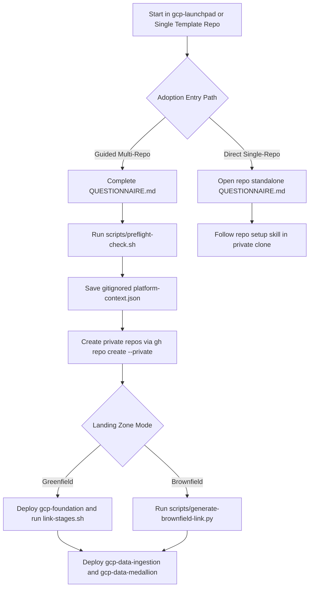

# GCP Launchpad

`gcp-launchpad` is the AI-native entry hub for the `choo737` Google Cloud template suite.

It routes teams from business requirements to private, production-ready repositories on Google Cloud.

## Template Suite Catalog

| Template Repository | Status | Included Capabilities | Best For |
| --- | --- | --- | --- |
| [gcp-foundation](https://github.com/choo737/gcp-foundation) | Active | Landing Zone, Multi-Env Folders (`dev`/`staging`/`prod`), Shared VPC, VPC-SC, Cloud KMS, SCC (`NONE`/`STANDARD`/`PREMIUM`), Locked Audit Logs, BigQuery Platform & Keyless GitHub WIF | Greenfield orgs, regulated FSI/BNM RMiT platforms, or brownfield data folders |
| [gcp-data-ingestion](https://github.com/choo737/gcp-data-ingestion) | Active | Datastream CDC (PSC/VPC), Zero-Dataflow Pub/Sub BigQuery Streaming + DLQ, Cloud Run v2 GCS Batch ELT + Quarantine, Cloud Workflows & Optional Composer 3 DAG | Greenfield linked from `gcp-foundation` or standalone Brownfield landing zones |
| [gcp-data-medallion](https://github.com/choo737/gcp-data-medallion) | Active | Dataform `3.1.5` SQLX Medallion (`01_bronze` -> `02_silver` SCD2 + Unified Orders -> `03_gold` marts), Dual-Tier PII Policy Tags, Dataplex Auto DQ & Tag-Gated Release Promotion | Greenfield or standalone Brownfield BigQuery Bronze tables (Datastream, Fivetran, Airbyte) |
| `gcp-webapp` *(Planned)* | Roadmap | Regional/Multi-Region HA Web App with External HTTPS Load Balancer, Cloud Armor WAF, Cloud Run v2, and Cloud SQL HA/DR | Customer portals and APIs on Greenfield or Brownfield VPCs |
| `gcp-adk-agent` *(Planned)* | Roadmap | Production Google ADK Agent with Vertex AI Agent Engine Runtime or Cloud Run v2, Evaluation Gate, Cloud Trace & Secret Manager | Enterprise AI agents routed via questionnaire runtime choice |

## Routing Architecture

Teams can start through `gcp-launchpad` for multi-repo setups or clone an individual template directly.



## Greenfield vs. Brownfield Routing

- **Greenfield mode**: Deploy `gcp-foundation` first, then export outputs with `link-stages.sh` into downstream repositories.
- **Brownfield mode**: Skip `gcp-foundation` and map existing VPC, Cloud KMS, and BigQuery IDs into `platform-context.json`.
- **Brownfield bridge**: Run `scripts/generate-brownfield-link.py` to emit `00_linked.auto.tfvars.json` for `gcp-data-ingestion/stages/enterprise`.
- **Single-repo adoption**: Each template repository keeps its own standalone `QUESTIONNAIRE.md` for direct Greenfield or Brownfield deployment.

## Quickstart Prompts

Always create private customer repositories with `--private` before saving customer identifiers or configuration files.

### Antigravity

```text
Read AGENTS.md, QUESTIONNAIRE.md, and .agents/skills/route-architecture/SKILL.md.
Guide me through the intake questions, run preflight checks, and write platform-context.json.
Create private customer repositories using gh repo create --private --template choo737/<template>.
```

### Claude Code

```text
Read CLAUDE.md, QUESTIONNAIRE.md, and .agents/skills/route-architecture/SKILL.md.
Help me choose Greenfield or Brownfield mode and generate gitignored platform-context.json.
Use gh repo create --private before cloning any template repository.
```

### OpenAI Codex

```text
Read AGENTS.md, README.md, and QUESTIONNAIRE.md.
Determine my compliance profile, run scripts/preflight-check.sh --dry-run, and prepare private template clones.
For Brownfield setups, load .agents/skills/brownfield-bridge/SKILL.md and generate 00_linked.auto.tfvars.json.
```

## Verification

```bash
make preflight
make test
```
