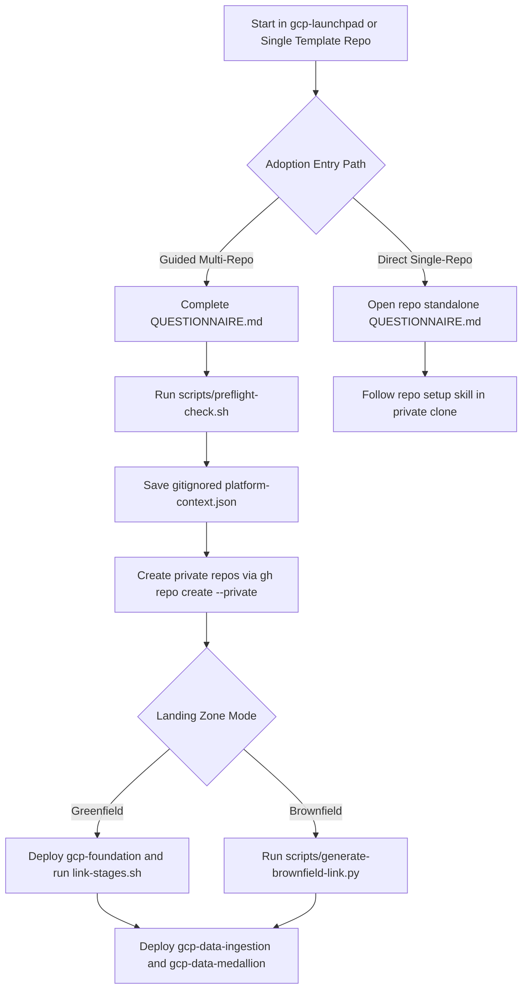

# GCP Launchpad

`gcp-launchpad` is the AI-native entry hub for the `choo737` Google Cloud template suite.

It routes teams from business requirements to private, production-ready Google Cloud repositories.

## Template Suite Overview

| Template Repository | Status | Included Capabilities | Best For |
| --- | --- | --- | --- |
| **gcp-launchpad** *(this repo — Suite Overview, Architecture Router & Brownfield Bridge)* | Active | Architecture intake questionnaire, preflight checks, Brownfield bridge generator, and cross-repo operational playbook | Multi-repo Greenfield or Brownfield planning and team handoffs |
| [gcp-foundation](https://github.com/choo737/gcp-foundation) | Active | Landing Zone, Multi-Env Folders (`dev`/`staging`/`prod`), Shared VPC, VPC-SC, Cloud KMS, SCC (`NONE`/`STANDARD`/`PREMIUM`), Locked Audit Logs, BigQuery Platform, and Keyless GitHub WIF | Greenfield orgs, regulated FSI/BNM RMiT platforms, or brownfield data folders |
| [gcp-data-ingestion](https://github.com/choo737/gcp-data-ingestion) | Active | Datastream CDC (PSC/VPC), Zero-Dataflow Pub/Sub BigQuery Streaming + DLQ, Cloud Run v2 GCS Batch ELT + Quarantine, Cloud Workflows, and Optional Composer 3 DAG | Greenfield linked from `gcp-foundation` or standalone Brownfield landing zones |
| [gcp-data-medallion](https://github.com/choo737/gcp-data-medallion) | Active | Dataform `3.1.5` SQLX Medallion (`01_bronze` -> `02_silver` SCD2 + Unified Orders -> `03_gold` marts), Dual-Tier PII Policy Tags, Dataplex Auto DQ, and Tag-Gated Release Promotion | Greenfield or standalone Brownfield BigQuery Bronze tables (Datastream, Fivetran, Airbyte) |
| `gcp-webapp` *(Planned)* | Roadmap | Regional/Multi-Region HA Web App with External HTTPS Load Balancer, Cloud Armor WAF, Cloud Run v2, and Cloud SQL HA/DR | Customer portals and APIs on Greenfield or Brownfield VPCs |
| `gcp-adk-agent` *(Planned)* | Roadmap | Production Google ADK Agent with Vertex AI Agent Engine Runtime or Cloud Run v2, Evaluation Gate, Cloud Trace, and Secret Manager | Enterprise AI agents routed via questionnaire runtime choice |

## Create Your Private Repository (Do Not Fork Publicly)

GitHub forces normal forks of public repositories to stay public.

Always create private customer repositories with `--private` before saving `platform-context.json` or cloning downstream templates.

```bash
gh repo create <org>/gcp-launchpad --private --template choo737/gcp-launchpad --clone
cd gcp-launchpad
gh repo view --json isPrivate --jq '.isPrivate'
```

Confirm `gh repo view` prints `true` before storing any customer identifiers.

## Architecture & Capabilities

Teams can start in `gcp-launchpad` for multi-repo platforms or adopt one downstream template directly.



- **Greenfield `link-stages.sh`**: Deploy `gcp-foundation` first, then run `link-stages.sh` to export outputs into downstream stages.
- **Brownfield `scripts/generate-brownfield-link.py`**: Skip `gcp-foundation` and write `00_linked.auto.tfvars.json` (`0600`) from existing landing zone IDs.
- **Single-repo adoption**: Each template keeps its own standalone `QUESTIONNAIRE.md` for direct adoption without `gcp-launchpad`.

## 6-Step Enterprise Operationalization

Follow the full cross-repository runbook in [docs/01-end-to-end-operational-playbook.md](docs/01-end-to-end-operational-playbook.md).

1. **Step 1 (Day 0)**: Complete [QUESTIONNAIRE.md](QUESTIONNAIRE.md), run `scripts/preflight-check.sh`, and write gitignored `platform-context.json`.
2. **Step 2 (Day 0)**: Create private repositories (`--private`), set `CODEOWNERS` and branch protection, and scope keyless GitHub WIF (`ci_repository_map`).
3. **Step 3 (Day 1)**: Deploy `gcp-foundation` (`00-bootstrap` -> `01-org-governance` -> `02-security-network` -> `data/enterprise/*`). For Brownfield, run `scripts/generate-brownfield-link.py`.
4. **Step 4 (Day 1)**: Deploy `gcp-data-ingestion` across `dev -> staging -> prod` with immutable loader digests and Secret Manager credentials.
5. **Step 5 (Day 1)**: Deploy `gcp-data-medallion` via PR dry-runs and cut an annotated `v1.0.0` Git tag to promote `prod-main`.
6. **Step 6 (Day 2)**: Onboard new business feeds across Ingestion (`tfvars` maps) and Medallion (`01_bronze`..`03_gold`). Update Foundation (`additional_quality_scans` or Gold domains) when needed.

## AI Coding Agent Quickstart

### Antigravity or OpenAI Codex

```text
Read AGENTS.md, QUESTIONNAIRE.md, and .agents/skills/route-architecture/SKILL.md.
Guide me through the intake questions, run scripts/preflight-check.sh, and write platform-context.json.
Create private customer repositories using gh repo create --private --template choo737/<template>.
```

### Claude Code

```text
Read CLAUDE.md, QUESTIONNAIRE.md, and .agents/skills/route-architecture/SKILL.md.
Help me choose Greenfield or Brownfield mode and generate gitignored platform-context.json.
For Brownfield setups, load .agents/skills/brownfield-bridge/SKILL.md and generate 00_linked.auto.tfvars.json.
```

| Skill | File | Purpose |
| --- | --- | --- |
| `route-architecture` | `.agents/skills/route-architecture/SKILL.md` | Guides intake questions, runs preflight checks, writes `platform-context.json`, and creates private repos |
| `brownfield-bridge` | `.agents/skills/brownfield-bridge/SKILL.md` | Inspects existing GCP resources, updates `platform-context.json`, and generates `00_linked.auto.tfvars.json` |

## CI/CD Workflows

Every push to `main` and every pull request runs `.github/workflows/ci.yml` on `ubuntu-latest`.

- Action references in `.github/workflows/ci.yml` are pinned to full 40-character commit SHAs.
- The workflow uses read-only `contents: read` permissions and avoids `${{ }}` interpolation inside `run:` blocks.
- CI executes `make preflight` (offline dry-run) and `make test` (structure, schema, prose, and security unit tests).

## Repository Layout

- `QUESTIONNAIRE.md`: Six-section Tier-1 intake questionnaire producing gitignored `platform-context.json`.
- `docs/`: End-to-end operational playbook and template documentation standard.
- `examples/`: Reference `platform-context.greenfield.json` and `platform-context.brownfield.json` contracts.
- `scripts/`: `preflight-check.sh` validator and `generate-brownfield-link.py` tfvars bridge (`0600`).
- `.agents/skills/`: Agent skills for `route-architecture` and `brownfield-bridge`.
- `CODEOWNERS`: Default repository reviewer ownership rules for template and workflow files.
- `tests/`: Hermetic Python `unittest` suite enforcing structure, scripts, schemas, CI hardening, and prose rules.

## Quick Verification

```bash
make preflight
make test
```

## Documentation Index

- [Tier-1 Architecture Router Questionnaire](QUESTIONNAIRE.md)
- [End-to-End Operational Playbook](docs/01-end-to-end-operational-playbook.md)
- [Template Documentation Standard](docs/02-template-documentation-standard.md)
- [gcp-foundation Enterprise Operationalization Guide](https://github.com/choo737/gcp-foundation/blob/main/docs/05-enterprise-operationalization-guide.md)
- [gcp-data-ingestion Enterprise Adoption Guide](https://github.com/choo737/gcp-data-ingestion/blob/main/docs/03-enterprise-adoption-guide.md)
- [gcp-data-medallion Enterprise Operationalization Guide](https://github.com/choo737/gcp-data-medallion/blob/main/docs/02-enterprise-operationalization-guide.md)

## License

Licensed under the Apache License 2.0 ([LICENSE](LICENSE)).
