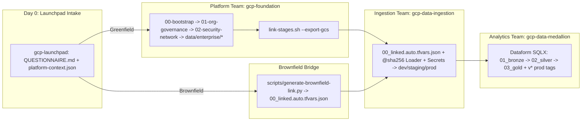

# End-to-End Operational Playbook

This playbook guides Platform, Ingestion, and Analytics teams from Day-0 setup through Day-2 operations.

It covers both Greenfield (`gcp-foundation`) and Brownfield (`scripts/generate-brownfield-link.py`) cross-repository deployments.



## Step 1 — Day 0: Architecture Intake & Private Repository Bootstrap

Complete architecture intake and create isolated private repositories before provisioning any Google Cloud resource.

1. Walk stakeholders through [QUESTIONNAIRE.md](../QUESTIONNAIRE.md) to lock compliance profile, regions, naming tokens, and repositories.
2. Run `bash scripts/preflight-check.sh --org <YOUR_ORG_ID>` to verify tools, `gcloud` identity, and `gh` authentication.
3. Save validated answers to gitignored `platform-context.json` matching `examples/platform-context.greenfield.json` or `examples/platform-context.brownfield.json`.
4. Create private customer clones with `gh repo create <org>/<repo> --private --template choo737/<template> --clone`.
5. Run `gh repo view --json isPrivate --jq '.isPrivate'` in every clone and confirm `true`.
6. Update `CODEOWNERS` with customer team slugs and protect `main` with required pull request reviews.
7. Create `dev`, `staging`, and `prod` GitHub Environments and require human reviewers on `prod`.
8. Deploy `gcp-foundation/foundation/00-bootstrap` and configure `ci_repository_map` to scope keyless GitHub OIDC WIF per repository.

## Step 2 — Day 1A: Landing Zone Rollout (`gcp-foundation`) or Brownfield Bridge

Provision the Greenfield landing zone in `gcp-foundation`, or run the Brownfield bridge on existing customer projects.

### Option A: Greenfield (`gcp-foundation`)

1. Deploy `foundation/01-org-governance` once to apply 36 Org Policies, locked audit bucket, FinOps budgets, and SCC tier.
2. Deploy `foundation/02-security-network` per environment (`dev`, `staging`, `prod`) for Shared VPC, KMS, NGFW, `BackupVault`, and VPC-SC.
3. Keep `enforce_vpc_sc = false` initially so VPC-SC runs in `DRY_RUN` mode while validating traffic.
4. Deploy `data/enterprise/01-platform` and `data/enterprise/02-governance-ops` per environment (`dev`, `staging`, `prod`).
5. Export non-sensitive stage outputs per environment to Cloud Storage with `scripts/link-stages.sh`.

```bash
./scripts/link-stages.sh --env <env> \
  --export-gcs gs://<iac-outputs-bucket>/foundation-outputs.json \
  foundation/02-security-network data/enterprise/01-platform data/enterprise/02-governance-ops
```

6. Inspect `DRY_RUN` VPC-SC logs in Log Analytics, update ingress rules, then flip `enforce_vpc_sc = true` (`DRY_RUN -> ENFORCED`).

### Option B: Brownfield Bridge (`gcp-launchpad`)

1. Follow `.agents/skills/brownfield-bridge/SKILL.md` using read-only `gcloud` and `bq` commands to verify existing IDs.
2. Populate `existing_landing_zone` inside gitignored `platform-context.json`.
3. Run `python3 scripts/generate-brownfield-link.py` targeting `gcp-data-ingestion/stages/enterprise/variables.tf`.
4. Verify the emitted `00_linked.auto.tfvars.json` has `0600` file permissions and remains gitignored.

## Step 3 — Day 1B: Ingestion Rollout (`gcp-data-ingestion`)

Deploy streaming, CDC, and batch Bronze pipelines using linked landing zone outputs and immutable container digests.

1. Link upstream stage outputs into `stages/enterprise` using `link-stages.sh` (Greenfield) or `generate-brownfield-link.py` (Brownfield).

```bash
./scripts/link-stages.sh --env <env> \
  --from-gcs gs://<iac-outputs-bucket>/foundation-outputs.json \
  stages/enterprise
```

2. Trigger `.github/workflows/build-batch-loader.yml` to build `jobs/gcs_to_bronze` and record its immutable `@sha256` digest.
3. Paste that `@sha256` digest into `batch_container_image` inside `stages/enterprise/envs/staging.tfvars` and `prod.tfvars`.
4. Store every source database replication password in regional Secret Manager (`gcloud secrets create`) and pass version paths only.
5. Deploy `dev` first with `enable_schedule = false` to validate pipelines safely with manual runs.
6. Promote `dev -> staging -> prod` through `.github/workflows/terraform-deploy.yml`, keeping `delete_contents_on_destroy = false` in `prod`.

## Step 4 — Day 1C: Medallion Warehouse Rollout (`gcp-data-medallion`)

Configure Dataform `3.1.5` SQLX transformations, dual-tier PII policy tags, and tag-gated production promotion.

1. Set default targets in `workflow_settings.yaml` and copy `envs/*.compilation.json.example` to gitignored `envs/<env>.compilation.json`.
2. Configure GitHub variables (`GCP_WIF_PROVIDER`, `GCP_WIF_SERVICE_ACCOUNT`, `DATAFORM_REPO_PATH`, `BRONZE_PROJECT`, `SILVER_PROJECT`, `GOLD_PROJECT`, and PII tags).
3. Open pull requests against `main` to run `.github/workflows/dataform-dryrun.yml` with strict PII enforcement (`allow_untagged_pii = "false"`).
4. Merge to `main` to update `dev-main` and `staging-main` Dataform release configs via `.github/workflows/dataform-promote.yml`.
5. Cut an annotated Git tag (`git tag -a v1.0.0 -m "Release v1.0.0"`) and push it to promote `prod-main`.

## Step 5 — Day 2: End-to-End Recipe to Onboard a New Business Data Source

Add new business feeds across Ingestion, Medallion, and Foundation using this exact pull request order.

1. **PR 1 (`gcp-data-ingestion`)**: Add schemas under `schemas/` and register the feed in `stages/enterprise/envs/<env>.tfvars` (`pubsub_streams`, `batch_jobs`, or `datastream_streams`).
2. **PR 2 (`gcp-data-medallion`)**: Add `definitions/01_bronze/` declaration, `definitions/02_silver/` incremental or SCD2 model with PII tags, `definitions/03_gold/` mart, and `quality/*.yaml`.
3. **PR 3 (`gcp-foundation`, optional)**: Update `domain_marts` in `01-platform` or `additional_quality_scans` in `02-governance-ops` when adding a Gold domain or scan.
4. **Canary in `dev`**: Apply `dev`, send one valid event and one malformed event, and verify target and `*_quarantine` tables.
5. **Promote to `prod`**: Promote Ingestion via `terraform-deploy.yml`, merge Medallion to `main`, and push an annotated `v*` Git tag.

## Step 6 — Day 2: Incident Triage, Drift-Safe Changes & Scale Triggers

Operate live pipelines with telemetry queries, quarantine replay, drift-safe Terraform applies, and planned domain splits.

- **Telemetry & alerts**: Query `<prefix>_ops_telemetry.pipeline_runs` (`execution_id`, `status`, `recorded_at`), `<prefix>_scc_findings`, and FinOps budget alerts.
- **DLQ & quarantine replay**: Inspect `<target_table_id>_quarantine` tables or GCS `quarantine/*.error.json` sidecars, fix payloads, and replay into `source_prefix`.
- **VPC-SC dry-run checks**: Test new principals and services in `DRY_RUN` mode in Log Analytics before updating `prod` enforced perimeters.
- **Drift-safe Terraform changes**: Run `make plan STAGE=<stage> ENV=<env> TFSTATE_BUCKET=<bucket>` before `make apply`, and import existing resources.
- **Scale triggers**: Split `gcp-data-ingestion` by domain (`split-domain-ingestion`), and split Gold marts (`split-domain-mesh`) when teams diverge.
