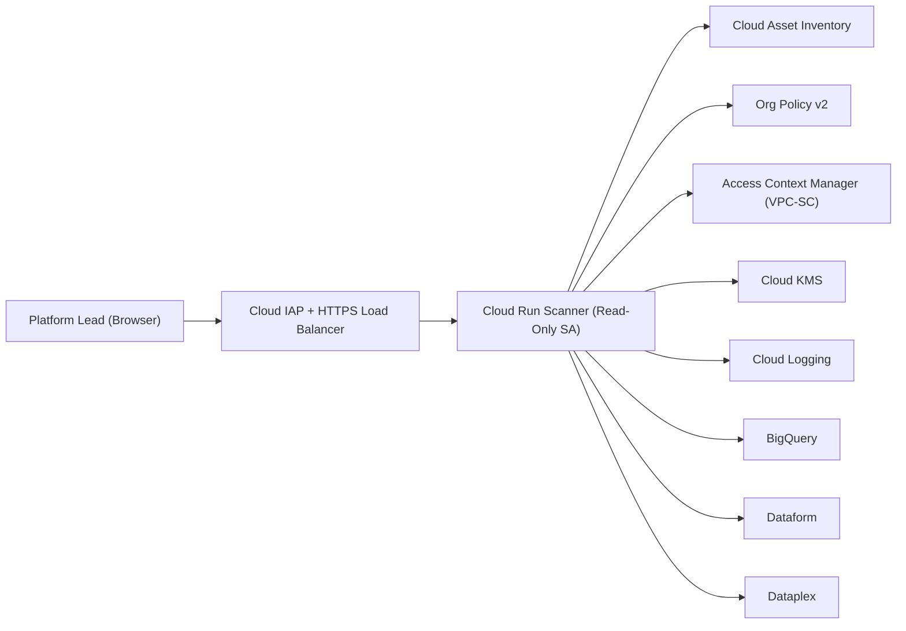

# Org Completeness Scanner Design

This specification defines a read-only Cloud City scanner for live Google Cloud organizations.

It maps existing GCP control-plane resources onto the twelve Cloud City districts (`D00` through `D11`).


## Scanner Architecture

A Cloud Run service behind Cloud IAP queries eight read-only GCP APIs on demand.

It never writes resources, mutates IAM bindings, or stores customer secrets outside ephemeral memory.



## 12-District Cloud City Control-Plane Matrix

Each district tracks one concrete layer of the four-tier suite from foundation to skyline.

| District | Cloud City Metaphor | Layer | Target GCP Services & APIs | Key Completeness Signals |
| --- | --- | --- | --- | --- |
| `D00` | Granite Bedrock | Layer 01 | Resource Manager (`folders`, `projects`) | `02-environments` tree, core, etl, governance projects |
| `D01` | Deep KMS Wiring & Vaults | Layer 01 | Cloud KMS (`keyRings`, `cryptoKeys`) | HSM or software CMEK rings per region |
| `D02` | Shared VPC Power Grid & Egress | Layer 01 | Compute Engine, Cloud DNS | Host VPC, private subnets, firewall deny-all egress |
| `D03` | City Hall & Guardrails | Layer 01 | Org Policy v2, Billing Budgets, SCC | 36 Org Policies enforced, budgets, SCC active |
| `D04` | VPC-SC Perimeter Wall & Gate | Layer 01 | Access Context Manager | Dry-run or enforced service perimeters and ingress |
| `D05` | Sealed Audit Bunker & Telemetry | Layer 01 | Cloud Logging, Project Liens | Locked `2555`-day audit bucket, Log Analytics, liens |
| `D06` | Bullet-Train CDC & Stream Station | Layer 02 | Datastream, Pub/Sub | Shared PSC connection, BigQuery subscriptions, DLQ topics |
| `D07` | GCS Freight Crane & Quarantine | Layer 02 | Cloud Storage, Cloud Run v2, Workflows | Landing bucket lifecycle, loader job, quarantine path |
| `D08` | Copper Bronze Raw Silos | Layer 03 | BigQuery (`datasets`, `tables`) | Partitioned Bronze and `*_quarantine` tables |
| `D09` | Overhead Dataform SQLX Piping | Layer 03 | Dataform (`repositories`, `releaseConfigs`) | Git remote, `dev`/`staging`/`prod` release configs |
| `D10` | Silver PII Lab & Gold Marts | Layer 03 | Data Catalog, Dataplex, BigQuery | Dual PII policy tags, AutoDQ scans, Gold marts |
| `D11` | AI Tower & Skybridge | Layer 04 | Cloud Run, Vertex AI (`gcp-webapp`, `gcp-adk-agent`) | Roadmap portal ingress and evaluated agent runtime |

## Completeness States

Each district renders one visual state from its live API coverage score.

| State | Score Range | Visual Treatment | Meaning |
| --- | --- | --- | --- |
| Complete | `100%` | Full color district | All expected control-plane resources exist and match policy |
| Partial or Drift | `1-99%` | Amber drift ring | Partial deployment or policy drift detected across active stages |
| Missing | `0%` | Frosted grayscale model | Layer or district not yet provisioned in target scope |

## Required Read-Only IAM Roles

Grant these four least-privilege roles to the scanner service account at the target folder or org.

| IAM Role | Covered APIs | Purpose |
| --- | --- | --- |
| `roles/cloudasset.viewer` | Cloud Asset Inventory | Discover folders, projects, VPCs, GCS, BigQuery, KMS, and Run |
| `roles/orgpolicy.policyViewer` | Org Policy v2 | Verify the 36 baseline Org Policy constraints |
| `roles/accesscontextmanager.policyReader` | Access Context Manager | Inspect dry-run and enforced VPC-SC perimeters |
| `roles/logging.viewer` | Cloud Logging | Check `2555`-day audit log sinks and locked buckets |

Add `roles/dataform.viewer` and `roles/dataplex.viewer` when scanning Layer 03 release configs and quality scans.

## Deterministic Verification Commands

Run `gcloud asset search-all-resources` with neutral folder or org scope to validate scanner coverage.

```bash
# Inspect folders and projects under the target organization
gcloud asset search-all-resources \
  --scope="organizations/<YOUR_ORG_ID>" \
  --asset-types="cloudresourcemanager.googleapis.com/Folder,cloudresourcemanager.googleapis.com/Project"

# Inspect KMS keys, Shared VPCs, and BigQuery datasets in a folder
gcloud asset search-all-resources \
  --scope="folders/<YOUR_FOLDER_ID>" \
  --asset-types="cloudkms.googleapis.com/CryptoKey,compute.googleapis.com/Network,bigquery.googleapis.com/Dataset"

# Inspect Cloud Run services, Workflows, Dataform repos, and Dataplex scans
gcloud asset search-all-resources \
  --scope="folders/<YOUR_FOLDER_ID>" \
  --asset-types="run.googleapis.com/Service,workflows.googleapis.com/Workflow,dataform.googleapis.com/Repository,dataplex.googleapis.com/DataScan"
```

Compare command output against `platform-context.json` before cutting over brownfield or greenfield environments.
