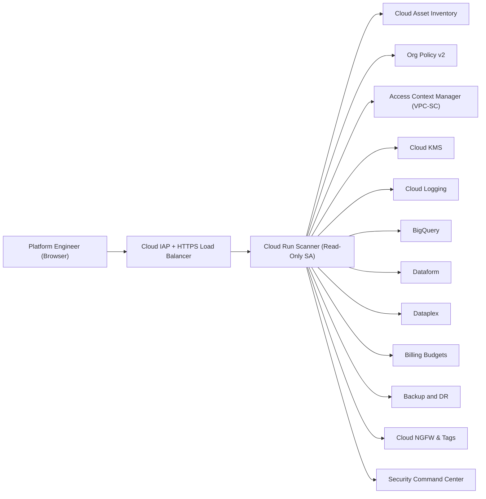

# Org Setup Check Design

This document specifies a read-only scanner for existing Google Cloud organizations.

It checks live GCP resources against sixteen platform areas (`D00` through `D15`).


## Scanner Architecture

A Cloud Run service behind Cloud IAP queries twelve read-only GCP APIs on demand.

It never writes resources, changes IAM bindings, or stores customer secrets on disk.



## 16-Area Control-Plane Checks

Each check maps one visual area on the diagram to concrete GCP APIs.

| ID | Diagram Area | Layer | GCP APIs Queried | Expected Signals |
| --- | --- | --- | --- | --- |
| `D00` | Bedrock | `01` | Resource Manager (`folders`, `projects`) | `02-environments` folders, core, compute, governance projects |
| `D01` | City hall | `01` | Cloud IAM, Org Policy v2, Billing Budgets | Group bindings, 36 Org Policies, active budgets |
| `D02` | Power substation | `01` | Compute Engine, Cloud DNS | Shared VPC host, private subnets, Cloud NAT |
| `D03` | Underground wiring | `01` | Cloud KMS (`keyRings`, `cryptoKeys`) | Regional CMEK rings and 90-day rotation |
| `D04` | Perimeter wall | `01` | Access Context Manager, SCC | Dry-run or enforced VPC-SC perimeters and SCC tier |
| `D05` | Log vault | `01` | Cloud Logging, Project Liens | Locked `2555`-day audit bucket, Log Analytics, liens |
| `D06` | Train station | `02` | Datastream, Pub/Sub | Private PSC link, BigQuery subscriptions, DLQ topics |
| `D07` | Cargo crane & customs | `02` | Cloud Storage, Cloud Run v2, Workflows | Landing and quarantine buckets, batch jobs, workflows |
| `D08` | Silos & pipes | `03` | BigQuery, Dataform | Partitioned Bronze tables, Dataform repo, release configs |
| `D09` | Filter lab & gold vaults | `03` | Data Catalog, Dataplex, BigQuery | PII policy tags, AutoDQ scans, Gold marts |
| `D10` | Office towers | `04` | Cloud Armor, Cloud Run, GKE, Cloud SQL | HTTPS load balancer, WAF policy, regional HA database |
| `D11` | Control tower & bridge | `04` | Vertex AI, Model Armor, Cloud Trace | ADK agent runtime (`gcp-adk-agent`), guardrails, traces |
| `D12` | FinOps treasury | `01` | Cloud Billing, Billing Budgets, BigQuery | Dedicated `<prefix>-cmn-finops` project, billing export dataset, multi-budget Google Group alert channels |
| `D13` | Backup vault | `01` | Backup and DR, Cloud Storage | Central `BackupVault` enforced retention, `BackupPlan` schedules, GCS `soft_delete_policy` |
| `D14` | Firewall fabric | `01` | Compute Engine, Resource Manager | Folder Hierarchical + VPC Global NGFW Threat Intelligence rules, `GCE_FIREWALL` IAM Secure Tags |
| `D15` | Security center | `01` | Security Command Center, Cloud KMS, Pub/Sub | Stage-01 Audit KMS CMEK on `<prefix>_scc_findings` export/Pub/Sub, active SCC runtime detectors |

## Status Values

| Status | Score | Diagram Treatment | Meaning |
| --- | --- | --- | --- |
| Complete | `100%` | Full color | Expected resources exist and match policy |
| Partial or drift | `1-99%` | Amber outline | Resources exist with missing settings or policy drift |
| Not deployed | `0%` | Gray model | Area is not provisioned in the scanned scope |

## Required Read-Only IAM Roles

Grant these four least-privilege roles to the scanner service account at the target folder or org.

| IAM Role | Covered APIs | Purpose |
| --- | --- | --- |
| `roles/cloudasset.viewer` | Cloud Asset Inventory | Discover folders, projects, VPCs, GCS, BigQuery, KMS, and Run |
| `roles/orgpolicy.policyViewer` | Org Policy v2 | Verify the 36 baseline Org Policy constraints |
| `roles/accesscontextmanager.policyReader` | Access Context Manager | Inspect dry-run and enforced VPC-SC perimeters |
| `roles/logging.viewer` | Cloud Logging | Check `2555`-day audit log sinks and locked buckets |

Add `roles/dataform.viewer` and `roles/dataplex.viewer` when scanning Layer 03 release configs and quality scans.

Add `roles/billing.viewer`, `roles/backupdr.viewer`, `roles/compute.networkViewer`, and `roles/securitycenter.findingsViewer` for `D12` through `D15` checks.

## Deterministic Verification Commands

Run `gcloud asset search-all-resources` with neutral folder or org scope to validate scanner coverage.

```bash
# Inspect folders and projects under the target organization
gcloud asset search-all-resources \
  --scope="organizations/<YOUR_ORG_ID>" \
  --asset-types="cloudresourcemanager.googleapis.com/Folder,cloudresourcemanager.googleapis.com/Project"

# Inspect KMS keys, Shared VPCs, and BigQuery datasets in a folder
gcloud asset search-all-resources \
  --scope="folders/<YOUR_FOLDER_ID>" \
  --asset-types="cloudkms.googleapis.com/CryptoKey,compute.googleapis.com/Network,bigquery.googleapis.com/Dataset"

# Inspect Cloud Run services, Workflows, Dataform repos, and Dataplex scans
gcloud asset search-all-resources \
  --scope="folders/<YOUR_FOLDER_ID>" \
  --asset-types="run.googleapis.com/Service,workflows.googleapis.com/Workflow,dataform.googleapis.com/Repository,dataplex.googleapis.com/DataScan"
```

Compare command output against `platform-context.json` before cutting over brownfield or greenfield environments.
