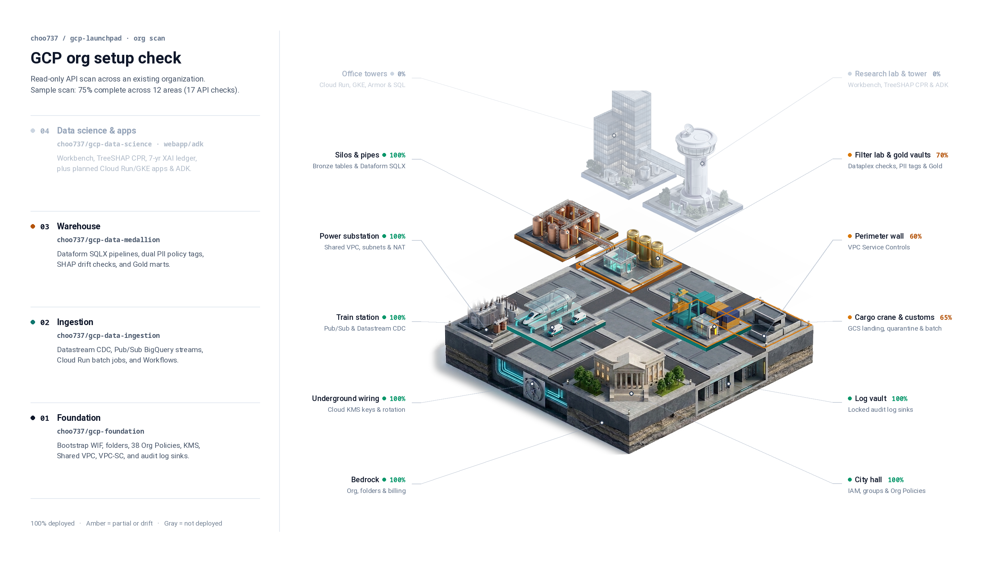
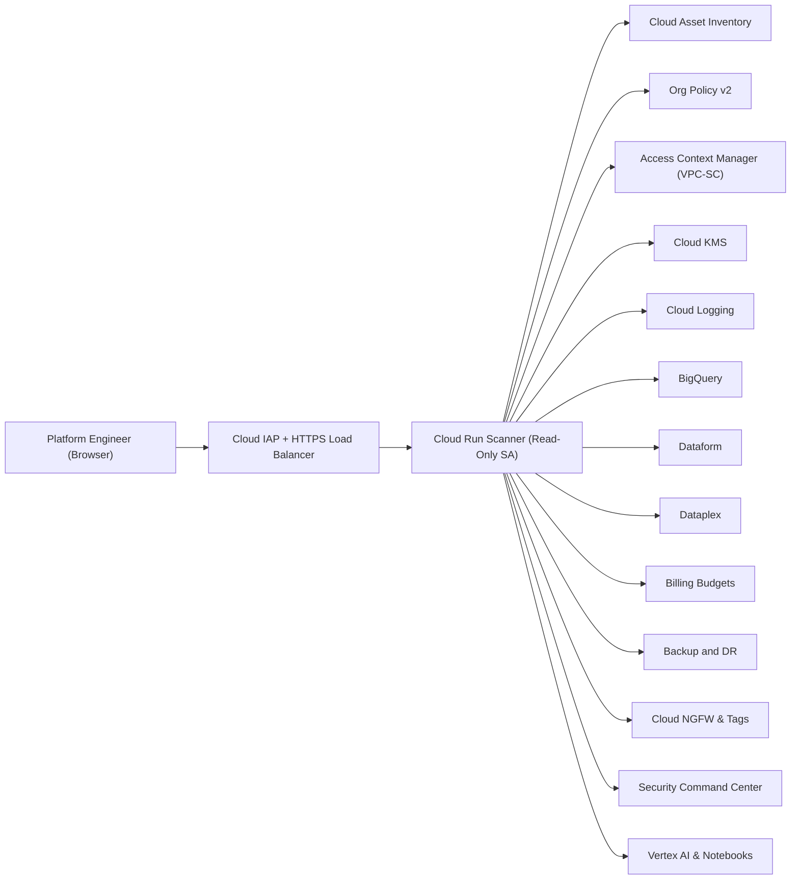

# Org Setup Check Design

This document specifies a read-only scanner for existing Google Cloud organizations.

It checks live GCP resources against seventeen platform areas (`D00` through `D16`).



## Scanner Architecture

A Cloud Run service behind Cloud IAP executes `17` read-only API checks on demand.

The visual diagram shows twelve physical areas (`D00` through `D11`).
Four Layer-`01` sub-checks (`D12` through `D15`) attach onto `D01`, `D05`, `D02`, and `D04`.
One Layer-`04` Data Science sub-check (`D16`) attaches onto `D11`.

It never writes resources, changes IAM bindings, or stores customer secrets on disk.



## 17-Area Control-Plane Checks

Checks `D00` through `D11` map to the twelve diagram areas.
Checks `D12` through `D15` verify Layer-`01` FinOps, Backup, NGFW, and SCC controls.
Check `D16` verifies Layer-`04` Data Science and regulated Explainable AI controls.

| ID | Diagram Area | Layer | GCP APIs Queried | Expected Signals |
| --- | --- | --- | --- | --- |
| `D00` | Bedrock | `01` | Resource Manager (`folders`, `projects`) | `02-environments` folders, core, compute, governance projects |
| `D01` | City hall | `01` | Cloud IAM, Org Policy v2, Billing Budgets | Group bindings, 36 Org Policies, active budgets |
| `D02` | Power substation | `01` | Compute Engine, Cloud DNS | Shared VPC host, private subnets, Cloud NAT |
| `D03` | Underground wiring | `01` | Cloud KMS (`keyRings`, `cryptoKeys`) | Regional CMEK rings and 90-day rotation |
| `D04` | Perimeter wall | `01` | Access Context Manager, SCC | Dry-run or enforced VPC-SC perimeters and SCC tier |
| `D05` | Log vault | `01` | Cloud Logging, Project Liens | Locked `2555`-day audit bucket, Log Analytics, liens |
| `D06` | Train station | `02` | Datastream, Pub/Sub | Private PSC link, BigQuery subscriptions, DLQ topics |
| `D07` | Cargo crane & customs | `02` | Cloud Storage, Cloud Run v2, Workflows | Landing and quarantine buckets, batch jobs, workflows |
| `D08` | Silos & pipes | `03` | BigQuery, Dataform | Partitioned Bronze tables, Dataform repo, release configs |
| `D09` | Filter lab & gold vaults | `03` | Data Catalog, Dataplex, BigQuery | PII policy tags, AutoDQ scans, Gold marts |
| `D10` | Office towers | `04` | Cloud Armor, Cloud Run, GKE, Cloud SQL | HTTPS load balancer, WAF policy, regional HA database |
| `D11` | Research lab & control tower | `04` | Vertex AI, Model Armor, Cloud Trace | Vertex AI Workbench, XAI CPR endpoints, ADK agents |
| `D12` | City hall (`D01` FinOps sub-check) | `01` | Cloud Billing, Billing Budgets, Monitoring, BigQuery | `<prefix>-cmn-finops` project, billing export dataset, budget alert channels |
| `D13` | Log vault (`D05` Backup sub-check) | `01` | Backup and DR, Cloud Storage | Central `BackupVault` enforced retention, `BackupPlan` schedules, GCS `soft_delete_policy` |
| `D14` | Power substation (`D02` NGFW sub-check) | `01` | Compute Engine, Resource Manager | Folder and VPC NGFW Threat Intelligence rules, `GCE_FIREWALL` tags |
| `D15` | Perimeter wall (`D04` SCC sub-check) | `01` | Security Command Center, Cloud KMS, Pub/Sub | Audit CMEK on `<prefix>_scc_findings` export, Pub/Sub, runtime detectors |
| `D16` | Research lab & control tower (`D11` Data Science & Regulated XAI sub-check) | `04` | Vertex AI, Notebooks, BigQuery, Cloud Storage | Hardened Workbench, zero `explanationSpec`, Bigtable FeatureOnlineStore, locked `ml_xai_audit_ledger` |

Check `D16` validates four Data Science and Explainable AI guardrails:

- **Hardened Workbench**: Verify `ainotebooks.disableRootAccess` and `disableFileDownloads` are enforced on every instance.
- **No deprecated `:explain`**: Verify zero Vertex Endpoints configure deprecated `explanationSpec`.
- **FeatureOnlineStore**: Verify Bigtable backing instead of the deprecated `optimized` tier.
- **Immutable XAI audit**: Verify `ml_xai_audit_ledger` and WORM bucket retention lock settings.

## Status Values

| Status | Score | Diagram Treatment | Meaning |
| --- | --- | --- | --- |
| Complete | `100%` | Full color | Expected resources exist and match policy |
| Partial or drift | `1-99%` | Amber outline | Resources exist with missing settings or policy drift |
| Not deployed | `0%` | Gray model | Area is not provisioned in the scanned scope |

## Required Read-Only IAM Roles

Grant these least-privilege roles to the scanner service account at the target folder or organization.
Bind `roles/billing.viewer` separately on the target **Cloud Billing Account**.

| IAM Role | Scope | Covered APIs | Purpose |
| --- | --- | --- | --- |
| `roles/cloudasset.viewer` | Org / Folder | Cloud Asset Inventory | Discover folders, projects, VPCs, GCS, BigQuery, KMS |
| `roles/orgpolicy.policyViewer` | Org / Folder | Org Policy v2 | Verify the 36 baseline Org Policy constraints |
| `roles/accesscontextmanager.policyReader` | Org | Access Context Manager | Inspect dry-run and enforced VPC-SC perimeters |
| `roles/logging.viewer` | Org / Folder | Cloud Logging | Check `2555`-day audit log sinks and locked buckets |
| `roles/dataform.viewer` | Folder / Project | Dataform | Inspect Dataform repositories and release configurations |
| `roles/dataplex.viewer` | Folder / Project | Dataplex | Inspect AutoDQ and data profile scans |
| `roles/compute.viewer` | Org / Folder | Compute Engine & Firewall Policy | Inspect Shared VPCs, subnets, and firewall policies without `.use` permissions |
| `roles/resourcemanager.tagViewer` | Org / Folder | Resource Manager Tags | Inspect `GCE_FIREWALL` IAM secure tag keys and values |
| `roles/monitoring.viewer` | Project | Cloud Monitoring | Inspect FinOps and SCC alert notification channels |
| `roles/backupdr.viewer` | Project | Backup and DR | Inspect `BackupVault` enforced retention and `BackupPlan` jobs |
| `roles/securitycenter.adminViewer` | Org / Folder | Security Command Center | Inspect SCC exports, notifications, mutes, and detectors |
| `roles/aiplatform.viewer` | Folder / Project | Vertex AI | Inspect Endpoints (`explanationSpec`), FeatureOnlineStores, and pipelines |
| `roles/notebooks.viewer` | Folder / Project | Vertex AI Workbench | Inspect Workbench instances, root access, and file downloads |
| `roles/billing.viewer` | **Cloud Billing Account** | Cloud Billing & Budgets | Inspect billing account export links and monthly budgets |

## Deterministic Verification Commands

Run `gcloud asset search-all-resources` and read-only CLI checks to validate all `17` areas.

```bash
# D00, D01, D05: Inspect folders and projects under the target organization
gcloud asset search-all-resources \
  --scope="organizations/<YOUR_ORG_ID>" \
  --asset-types="cloudresourcemanager.googleapis.com/Folder,cloudresourcemanager.googleapis.com/Project"

# D02, D03, D08, D09: Inspect KMS keys, Shared VPCs, and BigQuery datasets in a folder
gcloud asset search-all-resources \
  --scope="folders/<YOUR_FOLDER_ID>" \
  --asset-types="cloudkms.googleapis.com/CryptoKey,compute.googleapis.com/Network,bigquery.googleapis.com/Dataset"

# D06-D11: Inspect Cloud Run services, Workflows, Dataform repos, and Dataplex scans
gcloud asset search-all-resources \
  --scope="folders/<YOUR_FOLDER_ID>" \
  --asset-types="run.googleapis.com/Service,workflows.googleapis.com/Workflow,dataform.googleapis.com/Repository,dataplex.googleapis.com/DataScan"

# D12-D15: Inspect Backup vaults/plans, Firewall policies, Secure Tags, GCS buckets, and Pub/Sub topics
gcloud asset search-all-resources \
  --scope="folders/<YOUR_FOLDER_ID>" \
  --asset-types="backupdr.googleapis.com/BackupVault,backupdr.googleapis.com/BackupPlan,compute.googleapis.com/FirewallPolicy,cloudresourcemanager.googleapis.com/TagKey,storage.googleapis.com/Bucket,pubsub.googleapis.com/Topic"

# D12 & D15: Verify Cloud Billing budgets (Billing Account scope) and SCC BigQuery exports
gcloud billing budgets list --billing-account="<YOUR_BILLING_ACCOUNT_ID>"
gcloud scc bqexports list --folder="<YOUR_FOLDER_ID>" --location="global"

# D11 & D16: Inspect Vertex AI Endpoints, FeatureOnlineStores, and Workbench instances
gcloud asset search-all-resources \
  --scope="folders/<YOUR_FOLDER_ID>" \
  --asset-types="aiplatform.googleapis.com/Endpoint,aiplatform.googleapis.com/FeatureOnlineStore,notebooks.googleapis.com/Instance"
```

Compare command output against `platform-context.json` before cutting over brownfield or greenfield environments.
